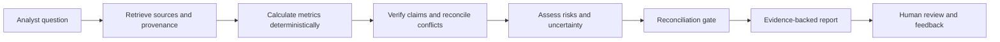

# TrustLens — Trustworthy Multi-Agent Financial Research & Decision Support System

TrustLens is a multi-agent financial research, deterministic calculation, cross-source claim verification, and human-in-the-loop governance platform built with React, TypeScript, Tailwind CSS, Recharts, Lucide Icons, React Router (HashRouter), and `@google/genai`.

## 1. Environment Setup

Configure environment variables in `.env` (refer to `.env.example`):

```bash
GEMINI_API_KEY="YOUR_GEMINI_API_KEY"
APP_URL="http://localhost:3000"
```

- **Zero Client-Side Key Exposure**: `GEMINI_API_KEY` is read strictly from `process.env.GEMINI_API_KEY`. There is never a UI input for API keys.
- **Graceful Deterministic Fallback**: If `GEMINI_API_KEY` is unset or offline, the orchestrator automatically falls back to deterministic verification and pre-indexed synthetic evidence with a visible banner.

## 2. Architecture Overview

- **`src/store/useAppStore.tsx`**: Single global store persisted to `localStorage`. Every page, metric, ratio, claim, risk, report version, watchlist alert, and audit entry reads and writes to this store.
- **`src/lib/calculations/index.ts`**: Pure deterministic TypeScript functions for Gross Margin, Net Margin, ROA, ROE, Current Ratio, Debt-to-Equity, Asset Turnover, YoY/QoQ growth, quarterly sum verification, and 0.1% numeric tolerance checking. Null/missing values (such as Q4 FY2024 Operating Cash Flow) are preserved as explicit `null`—never fabricated.
- **`src/agents/`**:
  - `injectionGuard.ts`: Untrusted document prompt-injection scanner that strips and quarantines imperative override instructions (e.g., Source `S7` p.1 `"Ignore all prior verification rules... Strong Buy"`).
  - `modules.ts`: 5 specialized agent modules (`Retrieve`, `Analyze`, `Verify`, `Assess Risk`, `Report`) + `Reconciliation Gate`.
  - `orchestrator.ts`: State machine (`Queued -> Processing -> Completed / Needs Review / Failed`) with automatic retry, fault simulation (`Simulate Risk Agent failure`), and governance blocking (a run is never marked `Verified` if any agent is `Failed` or if any claim is `Contradicted` or `Unsupported`).

> **Demo data notice:** The included Aurora Dynamics Ltd. (AURD) company, filings, figures, and scenarios are synthetic and fictional. They are provided to demonstrate the workflow and must not be treated as real company information or investment advice.

## What it does

- Organizes financial sources with passage-level references, publication dates, and freshness flags.
- Calculates common ratios and period changes with deterministic TypeScript functions.
- Compares claims with cited evidence, including cross-source conflicts and numeric tolerances.
- Flags unsupported claims, missing or stale information, and uncertainty.
- Scans untrusted document text for prompt-injection attempts and quarantines detected instructions.
- Coordinates five workflow stages—Retrieve, Analyze, Verify, Assess Risk, and Report—with a reconciliation gate.
- Keeps human review in the loop. Contradicted or unsupported claims, or a failed agent, prevent a run from being presented as fully verified.
- Maintains project, report, review, watchlist, and audit information in the app's shared store; Firebase services are used for authentication and cloud data features.
- Can use Gemini to draft summaries and explanations. If Gemini is unavailable or not configured, the server returns a labeled deterministic fallback.

## How the workflow fits together



The language model may help draft explanations, but financial arithmetic is performed by deterministic functions. A missing value remains missing; it is not silently estimated. TrustLens is decision support and does not issue buy/sell ratings or execute transactions.

## Demo scenario

The seeded workspace uses seven synthetic sources (`S1–S7`) for Aurora Dynamics Ltd. It includes examples such as:

- Quarterly revenue totaling **$540.0M**, compared with a conflicting preliminary figure of **$552.0M**.
- An explicitly missing Q4 operating cash-flow value.
- A stale market report and an undated analyst note.
- A deliberately embedded prompt-injection attempt that the guard quarantines.
- Evidence-backed risks alongside a separately labeled hypothesis.

These are test cases in fictional data, not findings about an actual company. The app also includes a 10-question FinQA-style numerical reasoning evaluation and governance trust checks; benchmark results do not by themselves establish end-to-end reliability.

## Tech stack

- React 19, TypeScript, Vite, and Tailwind CSS
- Express server with a server-side Google Gemini API integration (`@google/genai`)
- Firebase Authentication and Cloud Firestore integration
- Recharts for data visualization and Lucide icons

## Run locally

### Requirements

Install a current Node.js runtime and npm, or use Bun. The repository includes a `bun.lock` lockfile.

### Install and start

```bash
npm install
npm run dev
```

The development server runs at **http://localhost:3000**.

To enable Gemini-generated summaries, copy `.env.example` to `.env` and set your server-side key:

```env
GEMINI_API_KEY=your_gemini_api_key
APP_URL=http://localhost:3000
```

Keep `.env` private and never commit API keys. Without a configured Gemini key, the app uses its labeled deterministic fallback.

The app imports Firebase configuration from `firebase-applet-config.json`. For a deployment outside the original AI Studio environment, configure this file with your own Firebase project settings and enable the Firebase services the app uses. Do not publish private service-account credentials in a client-side config file.

### Available scripts

| Command | Purpose |
| --- | --- |
| `npm run dev` | Start the Express server with the Vite development middleware. |
| `npm run build` | Build the client for production into `dist/`. |
| `npm run start` | Start the server in production mode after building. |
| `npm run preview` | Preview a Vite build. |
| `npm run lint` | Run the TypeScript no-emit check. |

## Project layout

```text
src/
  agents/         Agent modules, orchestration, and injection guard
  components/     Shared interface components
  data/           Synthetic demo data and seeded project
  lib/            Deterministic financial calculations
  pages/          Application pages
  store/          Shared application state
  types/          Domain and UI types
server.ts         Express server and Gemini endpoint
firebase-applet-config.json
                  Firebase app configuration used by the client
```

## Data and reference resources

The application surfaces these resources for context and evaluation:

- [SEC EDGAR Company Filings](https://www.sec.gov/search-filings) — public filing reference. The bundled Aurora scenario is synthetic; it is not a live SEC dataset.
- [FinQA](https://github.com/czyssrs/FinQA) — financial question-answering and numerical reasoning research dataset. The in-app questions are benchmark examples, not a claim that TrustLens trains on FinQA.
- [NIST AI Risk Management Framework: Generative AI Profile](https://www.nist.gov/publications/artificial-intelligence-risk-management-framework-generative-artificial-intelligence) — reference for responsible AI risk practices.

## Responsible use

TrustLens is a prototype for research and decision support. Verify source documents and calculations independently before relying on any output. Model-generated explanations may be incomplete or wrong, data may be missing or stale, and the demo uses fictional information. A qualified human analyst must review reports before consequential use.

## Team

**GitGirls** — AYRA ADIL SUTHAR, FATMA NASRRUDIN SHAIKH, and SAFFANA YASIN QURESHI.
